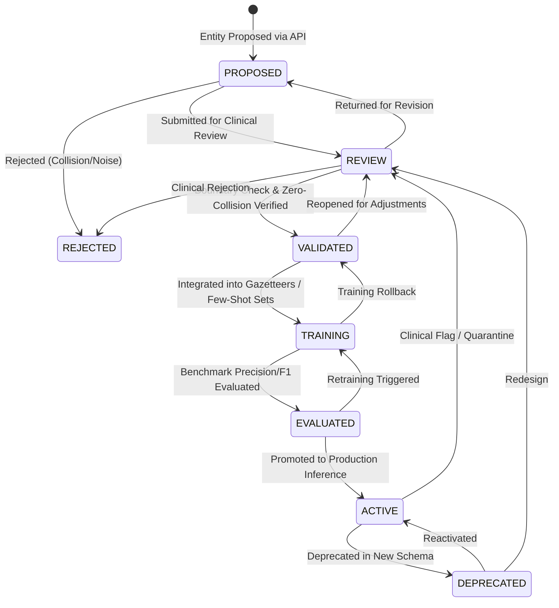

# NutriBite Dynamic Entity Registry — Architecture & API Specification

**Service:** NutriBite AI Microservice (FastAPI & MongoDB)  
**Phase:** Phase 2 — Dynamic Entity Registry Implementation  
**Schema Version:** 2.1.0  
**Baseline Compatibility:** Strict backward compatibility with 10-Entity Domain Schema (v2.0)  

---

## 1. System Overview

The **NutriBite Dynamic Entity Registry** provides dynamic, runtime management for newly validated clinical and culinary entity types beyond the frozen 10-entity baseline schema.

Selected from Phase 1 empirical corpus audit:
* **`COOKING_METHOD`** (Rank 1 — Primary Recommendation): Thermal, mechanical, and biochemical preparation methods (*sprouting, roasting, steaming, fermentation, boiling, mashing*).
* **`SUPPLEMENT`** (Rank 2 — Primary Recommendation): Pharmaceutical and clinical micronutrient formulations (*iron drops, IFA tablets, vitamin D drops, zinc syrup, ORS, RUTF*).
* **`DIET_PATTERN`** (Rank 3 — Alternative Candidate): High-level dietary regimens (*dietary diversity, balanced diet, plant-based diet*).

---

## 2. Entity Lifecycle State Machine

Dynamic entities advance through a 6-stage lifecycle:



### Lifecycle Gate Rules:
1. **`PROPOSED`**: Initial registration with name, aliases, description, and seed examples.
2. **`REVIEW`**: Clinical and NLP validation against boundary conflicts and semantic ambiguity.
3. **`VALIDATED`**: Zero-collision check with the 10 static frozen entities (`NUTRIENT`, `FOOD`, `FOOD_GROUP`, `DIETARY_PROPERTY`, `FEEDING_METHOD`, `HEALTH_CONDITION`, `ALLERGEN`, `AGE_GROUP`, `MEAL_TYPE`, `GROWTH_METRIC`).
4. **`TRAINING`**: Synthetic few-shot generation and gazetteer index construction.
5. **`EVALUATED`**: Offline benchmark evaluation ($F_1 \ge 0.85$ requirement).
6. **`ACTIVE`**: Available for dynamic sequence tagging and downstream RAG query routing.

---

## 3. Data Model & MongoDB Schema

### 3.1 MongoDB / Mongoose Schema (`backend/models/DynamicEntity.model.js`)
```javascript
const DynamicEntitySchema = new mongoose.Schema({
  name: { type: String, required: true, unique: true, uppercase: true },
  display_name: { type: String, required: true },
  category: { type: String, required: true },
  description: { type: String, required: true },
  aliases: [{ type: String, lowercase: true }],
  seed_examples: [{
    text: String,
    surface_span: String,
    start_char: Number,
    end_char: Number,
    source_context: String,
    clinical_notes: String
  }],
  schema_version: { type: String, default: '2.1.0' },
  status: {
    type: String,
    enum: ['PROPOSED', 'REVIEW', 'VALIDATED', 'TRAINING', 'EVALUATED', 'ACTIVE', 'DEPRECATED', 'REJECTED'],
    default: 'PROPOSED'
  },
  precedence_rank: { type: Number, default: 50 },
  downstream_rag_use: String,
  metadata: mongoose.Schema.Types.Mixed,
  lifecycle_history: [{
    from_status: String,
    to_status: String,
    changed_by: String,
    reason: String,
    timestamp: Date
  }]
}, { timestamps: true });
```

---

## 4. FastAPI REST Endpoints

Base URL: `http://localhost:8000/api/v1/entities`

| HTTP Method | Endpoint | Description | Request Body / Query Params |
| :--- | :--- | :--- | :--- |
| `POST` | `/api/v1/entities` | Register / propose new dynamic entity | `DynamicEntityCreate` |
| `GET` | `/api/v1/entities` | List dynamic entities with filters | `status`, `category`, `schema_version`, `search` |
| `GET` | `/api/v1/entities/{id_or_name}` | Fetch entity details | Path param: `COOKING_METHOD` |
| `PUT` | `/api/v1/entities/{id_or_name}` | Update entity metadata/aliases/examples | `DynamicEntityUpdate` |
| `PATCH` | `/api/v1/entities/{id_or_name}/lifecycle` | Transition lifecycle state | `DynamicEntityLifecycleUpdate` |
| `POST` | `/api/v1/entities/discover` | Phase 3 candidate discovery over RAG corpus | `DiscoveryThresholds` body; `entities`, `persist` query params |
| `POST` | `/api/v1/entities/seed-defaults` | Seed Phase 1 default entities | None |
| `DELETE` | `/api/v1/entities/{id_or_name}` | Remove / deregister entity | None |

---

## 5. Seeded Phase 1 Entity Profiles

### 5.1 `COOKING_METHOD` (Active)
* **Precedence Rank:** 45
* **Category:** Culinary & Biochemical Processing
* **Aliases:** `steaming`, `steamed`, `boiling`, `boiled`, `roasting`, `roasted`, `pressure cooking`, `fermentation`, `fermented`, `sprouting`, `sprouted`, `mashing`, `mashed`, `pureeing`, `pureed`, `blanching`, `sauteing`, `soaking`.
* **Seed Examples:**
  1. *"Sprouting and fermenting pulses enhances iron and zinc bioavailability in infant porridges."* (`Sprouting`)
  2. *"Provide steamed and mashed vegetables during early complementary feeding to prevent choking."* (`steamed`)
  3. *"Boiled eggs and pressure cooked lentils are easy for toddlers to digest."* (`Boiled`)

### 5.2 `SUPPLEMENT` (Active)
* **Precedence Rank:** 35
* **Category:** Clinical & Pharmaceutical Formulations
* **Aliases:** `iron drops`, `iron syrup`, `ifa tablets`, `ifa syrup`, `vitamin d drops`, `zinc supplementation`, `zinc syrup`, `zinc tablets`, `ors`, `rutf`, `therapeutic food`, `micronutrient powder`.
* **Seed Examples:**
  1. *"Infants diagnosed with severe anemia require pediatric iron drops alongside vitamin C rich fruits."* (`iron drops`)
  2. *"Administer zinc supplementation and ORS solution immediately during acute pediatric diarrhea."* (`zinc supplementation`)
  3. *"Children with severe acute malnutrition are managed with ready-to-use therapeutic food (RUTF)."* (`RUTF`)

### 5.3 `DIET_PATTERN` (Validated)
* **Precedence Rank:** 55
* **Category:** Macro Nutritional Paradigms
* **Aliases:** `balanced diet`, `dietary diversity`, `diversified diet`, `plant-based diet`, `vegetarian diet`, `traditional diet`, `complementary diet`.

---

## 6. Verification & Test Execution

Run the registry test suite:
```bash
python -m pytest tests/test_dynamic_entity_registry.py tests/test_candidate_discovery.py -v
python -m pytest ai-service-v2/tests/api/test_dynamic_entities.py ai-service-v2/tests/api/test_candidate_discovery_api.py -v
```
