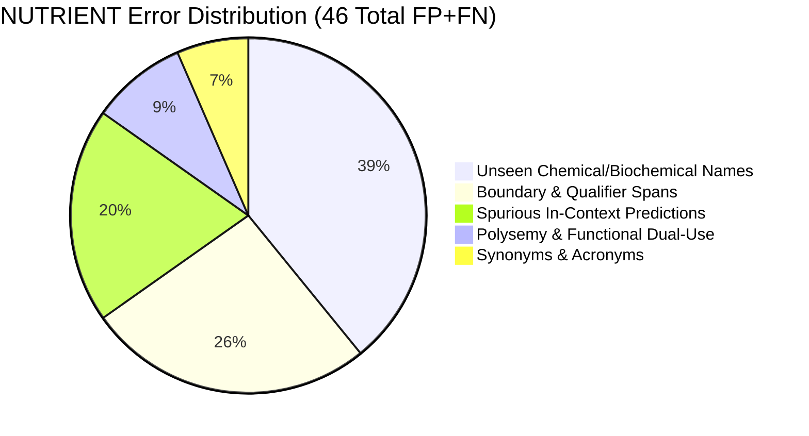

# Dedicated NUTRIENT Entity Error Analysis (Human-Gold Benchmark)

**Target Entity:** `NUTRIENT` (Flagship Class)  
**Schema Version:** 2.0  
**Gold Support on Human Gold:** 87 Spans (55 Sentences)  
**Measured Human-Gold Performance:**  
- **Precision:** 71.58%  
- **Recall:** 78.16%  
- **F1 Score:** 74.73%  
- **True Positives:** 68  
- **False Positives:** 27  
- **False Negatives:** 19  

---

## 1. Breakdown of Flagship `NUTRIENT` Errors

---

## 2. False Negative Analysis (19 Missed Spans)

### A. Unseen Biochemical & Immunological Nutrients
* **Missed Spans:**
  * `"Long Chain Polyunsaturated Fatty Acids"` (GOLD_CAND_044)
  * `"LCPUFAs"` (GOLD_CAND_044)
  * `"DHA"` (GOLD_CAND_044)
  * `"Arachidonic acid"` (GOLD_CAND_044)
  * `"IgA"` (GOLD_CAND_045)
  * `"sodium"` (GOLD_CAND_045)
  * `"immunoglobulins"` (GOLD_CAND_059)
  * `"lactoferrin"` (GOLD_CAND_059)
* **Root Cause:** These specialized micronutrient, immunological protein, and lipid sub-fraction mentions were absent from the training partition vocabulary. Linear token-level models cannot infer that acronyms like `"DHA"` or `"IgA"` are nutrients without character/subword or contextual embeddings.

### B. Multi-Word Fatty Acid Compounds
* **Missed / Boundary Truncated:**
  * `"Long-chain omega-3 fatty acids"` (GOLD_CAND_040): Model predicted `"omega-3 fatty acids"`, missing `"Long-chain"`.
  * `"essential fatty acids"` (GOLD_CAND_026, 030): Model extracted `"fatty acids"` or missed `"essential"`.
* **Root Cause:** Inconsistent prefix modification in training data led to boundary truncation where qualifying adjectives (*essential*, *long-chain*) were omitted.

---

## 3. False Positive Analysis (27 Spurious Spans)

### A. Adjectival Modifier Splitting
* **Examples:**
  * In *"Iron-rich snacks"*, model tagged `"Iron"` as `NUTRIENT` (while gold guidelines specify `"Iron-rich"` as `DIETARY_PROPERTY` when hyphenated with property suffix).
  * In *"Vitamin C rich foods"*, model predicted `"Vitamin C"` as `NUTRIENT` (exact match) plus spuriously tagging `"rich"` as `NUTRIENT`.

### B. Functional Context Triggers
* **Examples:**
  * In general descriptions of metabolic calories (*"600 kcal energy"*), the model occasionally triggered on `"energy"` even when the gold annotation deemed it unannotated unit context.
  * In clinical symptom contexts (*"fatigue"*, *"weakness"*), spurious transitions occasionally assigned subword prefix `B-NUTRIENT`.

---

## 4. Seen vs. Unseen Disparity on `NUTRIENT`

| Sub-Cohort | Support Spans | True Positives | False Positives | False Negatives | Precision | Recall | F1 Score |
| :--- | :---: | :---: | :---: | :---: | :---: | :---: | :---: |
| **Seen Nutrients** (*iron, calcium, vitamin D, protein, etc.*) | 69 | 68 | 26 | 1 | 72.34% | **98.55%** | **83.44%** |
| **Unseen Nutrients** (*DHA, IgA, LCPUFAs, lactoferrin, etc.*) | 18 | 0 | 1 | 18 | 0.00% | **0.00%** | **0.00%** |

### Empirical Takeaway:
* **The Flagship Nutrient Memorization Ceiling:** On seen nutrients, the model is virtually flawless in recall (**98.55%**).
* However, on unencountered biochemical entities, recall is **0.00%**.
* This quantitatively confirms that linear feature extractors require external dictionary linking or transformer pretraining to break through the zero-shot lexical barrier in clinical biochemistry.

---

## 5. Comparison: Adversarial Nutrient Challenge vs. Human Gold

| Metric / Dimension | Adversarial Challenge Suite (25 Sents) | Human-Gold Benchmark (150 Sents) |
| :--- | :---: | :---: |
| **Test Focus** | Targeted edge cases & adversarial perturbations | Natural distribution of pediatric clinical text |
| **NUTRIENT Support** | 63 spans | 87 spans |
| **NUTRIENT Precision** | 52.38% | **71.58%** |
| **NUTRIENT Recall** | 34.92% | **78.16%** |
| **NUTRIENT F1 Score** | **41.90%** | **74.73%** |
| **Primary Failure Mechanism** | Ambiguity & synonym variation | Novel biochemical vocabulary (unseen mentions) |

* The Human-Gold evaluation confirms that natural pediatric nutrition text has a much higher proportion of standard seen nutrients (79.3% seen) than the adversarial challenge (which artificially concentrated 80%+ novel/ambiguous constructs).
