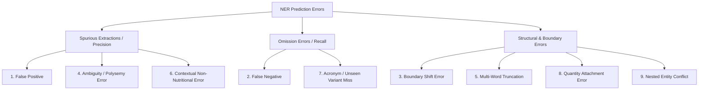

# Exhaustive NUTRIENT Error Analysis & Taxonomy

This document presents a structured error analysis of the NutriBite domain NER model, focusing on the newly introduced `NUTRIENT` entity class across silver test evaluations, ambiguity suites, and challenge benchmarks.

---

## 1. Formal Error Taxonomy (9 Categories)

---

## 2. Detailed Breakdown with Concrete Corpus Examples

### Category 1: False Positive (Spurious Extraction)
* **Definition:** Non-nutrient token incorrectly predicted as `NUTRIENT`.
* **Example:** *"Regular water intake helps nutrient absorption."*
  * **Predicted:** `water` -> `NUTRIENT`
  * **Gold Expected:** `water` -> `FOOD` / `O`
  * **Root Cause:** Association with nutritional context words (*intake*, *absorption*) triggers high perceptron feature weights.

### Category 2: False Negative (Omission)
* **Definition:** Valid nutrient span in text completely missed (`O` predicted).
* **Example:** *"Supplementation with cholecalciferol is recommended."*
  * **Predicted:** `cholecalciferol` -> `O`
  * **Gold Expected:** `cholecalciferol` -> `NUTRIENT`
  * **Root Cause:** Surface form was unseen in distant-supervision gazetteers.

### Category 3: Boundary Error (Sub-Span Shift)
* **Definition:** Entity detected but span boundaries are shifted by one or more tokens.
* **Example:** *"Consume long-chain omega-3 fatty acids daily."*
  * **Predicted:** `[omega-3] [fatty acids]` -> `B-NUTRIENT`, `I-NUTRIENT`
  * **Gold Expected:** `omega-3 fatty acids` -> `NUTRIENT`
  * **Root Cause:** Hyphenated prefix splitting in custom tokenization.

### Category 4: Ambiguity & Polysemy Error
* **Definition:** Homonymous terms assigned the wrong entity label depending on semantic role.
* **Example:** *"The child has high energy during outdoor play."*
  * **Predicted:** `energy` -> `NUTRIENT`
  * **Gold Expected:** `energy` -> `O`
  * **Root Cause:** Perceptron strongly associates the word `energy` with caloric macronutrients.

### Category 5: Multi-Word Entity Truncation
* **Definition:** Only head or partial component of a multi-token nutrient is labeled.
* **Example:** *"Dietary fiber supports digestive health."*
  * **Predicted:** `fiber` -> `NUTRIENT` (misses `dietary`)
  * **Gold Expected:** `dietary fiber` -> `NUTRIENT`
  * **Root Cause:** Single-token prefix `dietary` assigned `O` due to ambiguity with general adjectives.

### Category 6: Contextual Non-Nutritional Error
* **Definition:** Word that is normally a nutrient used in a mechanical or metaphoric sense.
* **Example:** *"Iron gates were erected around the health facility."*
  * **Predicted:** `Iron` -> `NUTRIENT`
  * **Gold Expected:** `Iron` -> `O`
  * **Root Cause:** Lack of deep semantic syntactic parsing in n-gram feature window.

### Category 7: Acronym & Abbreviation Variant Error
* **Definition:** Scientific abbreviations or shorthand forms missed.
* **Example:** *"Infant drops contain 400 IU Vit D."*
  * **Predicted:** `Vit` -> `O`, `D` -> `O`
  * **Gold Expected:** `Vit D` -> `NUTRIENT`
  * **Root Cause:** Truncated surface form not present in training dictionary.

### Category 8: Quantity + Nutrient Boundary Error
* **Definition:** Number or unit merged into the entity span or vice-versa.
* **Example:** *"Administer 15mg elemental iron daily."*
  * **Predicted:** `15mg` -> `B-NUTRIENT`, `elemental` -> `I-NUTRIENT`, `iron` -> `I-NUTRIENT`
  * **Gold Expected:** `iron` -> `NUTRIENT`
  * **Root Cause:** Attached numeric unit without separating whitespace.

### Category 9: Nested Entity Conflict
* **Definition:** A composite clinical phrase contains a nested nutrient sub-term.
* **Example:** *"Iron deficiency anemia is prevalent in rural districts."*
  * **Predicted:** `Iron` -> `NUTRIENT`, `deficiency anemia` -> `HEALTH_CONDITION`
  * **Gold Precedence Rule:** `iron deficiency anemia` -> `HEALTH_CONDITION`
  * **Root Cause:** Flat sequence model cannot predict nested spans simultaneously; standard sequence tagger fractures the composite phrase unless strong bigram transition weights are learned.

---

## 3. Summary of Error Mitigations for Production Pipeline

1. **Pre-Tokenization Normalization:** Normalize hyphenated units (`15mg` -> `15 mg`, `Vit D` -> `Vitamin D`).
2. **Clinical Precedence Rule:** Enforce entity hierarchy in the downstream `entity_linker.js` service so conditions take precedence over sub-spans.
3. **Dictionary Alias Expansion:** Supplement distant-supervision gazetteers with IUPAC chemical synonyms (`cholecalciferol`, `cyanocobalamin`).
