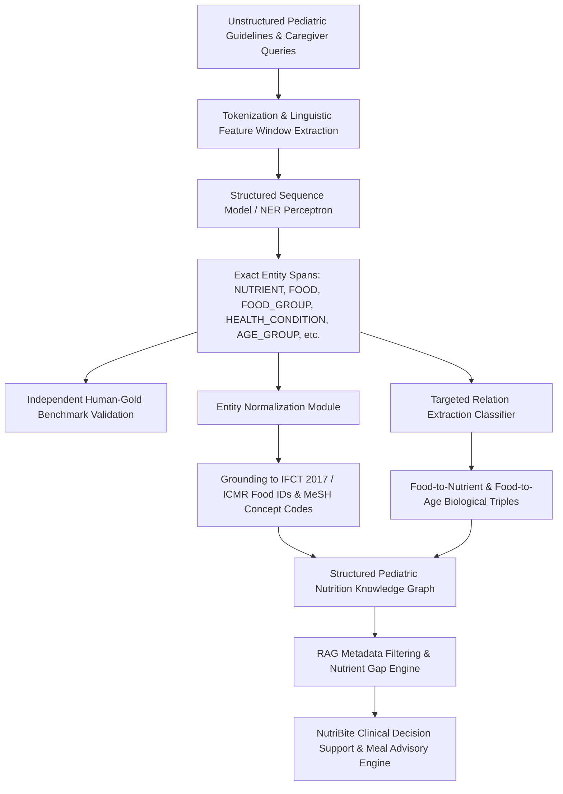

# Research-Level Pediatric Nutrition Information Extraction Pipeline

**Project:** NutriBite Pediatric Nutrition NLP System  
**Phase:** Phase 7 — Research-Level Schema Expansion Audit  
**Strategic Decision:** **Option B + Selective Option C** (Domain-Specific NER + Entity Normalization + Targeted Relation Extraction)  

---

## 1. Strategic Research Architecture Selection

Based on the empirical corpus audit in Phase 7, we evaluated three prospective architectures:

```
                            RESEARCH ARCHITECTURE COMPARISON
   
   ┌───────────────────────────────────┬────────────────────────────────────────────────────────┐
   │ ARCHITECTURE OPTION               │ EMPIRICAL FEASIBILITY & SCIENTIFIC VALUE               │
   ├───────────────────────────────────┼────────────────────────────────────────────────────────┤
   │ Option A: Domain NER Only         │ • Baseline completed (Micro F1: 95.10%).               │
   │                                   │ • Lacks entity grounding to structured food databases. │
   ├───────────────────────────────────┼────────────────────────────────────────────────────────┤
   │ Option B: Domain NER +            │ • HIGHLY FEASIBLE & RECOMMENDED.                       │
   │           Entity Normalization    │ • Grounds text spans to IFCT/ICMR food codes and RDA.  │
   │                                   │ • Direct bridge between unstructured text and RAG.     │
   ├───────────────────────────────────┼────────────────────────────────────────────────────────┤
   │ Option C: Domain NER +            │ • RECOMMENDED WITH SELECTIVE SCOPE.                    │
   │           Normalization +         │ • Feasible for FOOD->CONTAINS->NUTRIENT (70 matches)   │
   │           Relation Extraction     │   and FOOD->SUITABLE_FOR->AGE_GROUP (335 matches).     │
   │                                   │ • Arbitrary multi-class RE is rejected due to sparsity.│
   └───────────────────────────────────┴────────────────────────────────────────────────────────┘
```

**Final Strategic Selection:** **Option B with Targeted Option C** (focusing on high-confidence relations).

---

## 2. End-to-End Information Extraction Pipeline

The research-level pipeline integrates sequence labeling, entity normalization, relation induction, and downstream RAG query enrichment:



---

## 3. Pipeline Module Specifications

### Module 1: Corpus Preprocessing & Feature Extraction
* **Input:** Raw conversational text or guideline passage.
* **Operations:** Standard whitespace and punctuation preservation tokenization; n-gram window generation ($w_{i-1}, w_i, w_{i+1}$); subword prefix/suffix extraction; orthographic shape flags; dynamic previous BIO state tracking.

### Module 2: Sequence Labeling Engine
* **Architecture:** Structured Averaged Sequence Perceptron with constrained BIO decoding (guaranteeing 0 illegal transition errors).
* **Target Schema:** 10-class recommended schema centered on the flagship `NUTRIENT` entity.
* **Latency:** Sub-millisecond CPU inference per sentence, enabling real-time conversational processing.

### Module 3: Independent Evaluation & Quality Control
* **Validation:** Dual-track benchmark separating silver distant-supervision evaluation from independent 150-sentence Human-Gold validation (`12_validate_human_gold.py` and `11_evaluate_human_gold.py`).
* **Diagnostic Benchmarks:** 25-sentence adversarial Nutrient Challenge Suite testing chemical IUPAC synonyms, polysemy, and boundary shifts.

### Module 4: Entity Normalization & Grounding
* **Target:** Maps raw text spans to canonical ontology IDs:
  * `"ragi"` $\rightarrow$ `IFCT_CEREAL_001` (Finger Millet, 328 kcal/100g, 344mg Calcium)
  * `"iron"` $\rightarrow$ `NUT_FE_ELEMENTAL` (ICMR RDA RDA-2020)
  * `"vitamin D"` $\rightarrow$ `NUT_VIT_D3` (Cholecalciferol)
  * `"stunting"` $\rightarrow$ `WHO_ANTHRO_HAZ_MINUS2` (Height-for-Age $Z < -2$)

### Module 5: Targeted Relation Extraction
* **Scope:** Classifies candidate entity pairs co-occurring in the same sentence:
  1. $\text{Rel}_{\text{contains}}: (\text{FOOD}, \text{NUTRIENT}) \rightarrow \{\text{CONTAINS}, \text{NONE}\}$
  2. $\text{Rel}_{\text{suitability}}: (\text{FOOD}, \text{AGE\_GROUP}) \rightarrow \{\text{SUITABLE\_FOR}, \text{NONE}\}$

### Module 6: Downstream RAG Query Enrichment & Safety Validation
* **Integration:** Converts unstructured parent questions into structured hybrid search filters (`rag_enricher.js`), routing queries to age-matched guideline chunks and cross-referencing foods against pediatric allergen safety tables.
