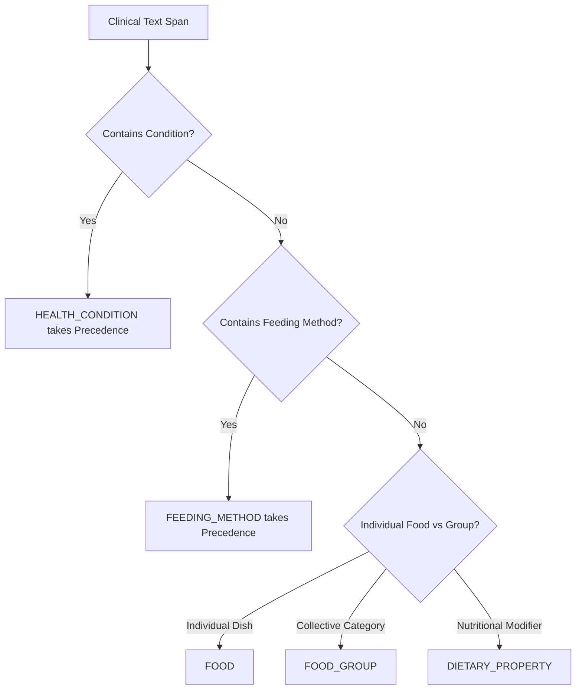

# Schema Expansion Recommendations & Evaluation Analysis

**Project:** NutriBite Pediatric Nutrition NLP System  
**Phase:** Phase 7 — Research-Level Schema Expansion Audit  
**Objective:** Evidence-based classification of candidate entity categories into Recommended, Future Extension, and Rejected groups  

---

## 1. Multi-Criteria Evaluation Framework (Criteria A–G)

Each candidate category was evaluated against seven rigorous NLP criteria:
* **Criterion A (Corpus Support):** Does the natural-language corpus contain sufficient instances ($\ge 50$ mentions) for statistical modeling?
* **Criterion B (Semantic Clarity):** Can human annotators distinguish the boundaries and semantic scope with high inter-annotator agreement?
* **Criterion C (Domain Relevance):** Is the concept central to pediatric clinical nutrition?
* **Criterion D (Downstream Utility):** Does the extracted entity directly drive NutriBite platform functions (RAG filtering, RDA gap calculation, meal safety)?
* **Criterion E (Evaluation Feasibility):** Are there enough test-set instances to compute reliable precision, recall, and F1 scores?
* **Criterion F (Low Redundancy):** Is the entity distinct from existing categories, avoiding unnecessary label fragmentation?
* **Criterion G (Research Value):** Does introducing the entity advance information extraction in biomedical/nutritional NLP?

---

## 2. Categorization: Groups A, B, and C

### Group A: Recommended Entities (Strong Corpus Evidence & High Clinical Value)

```
                            GROUP A: RECOMMENDED ENTITIES
   
   1. FOOD_GROUP (374 mentions | 171 docs | Low Ambiguity)
      • Rationale: Separates broad dietary categories (pulses, cereals, green leafy vegetables)
        from individual dishes/foods (khichdi, curd, apple).
      • Clinical Utility: Drives WHO Infant and Young Child Feeding (IYCF) Minimum Dietary
        Diversity (MDD) tracking (>= 5 of 8 food groups daily).
   
   2. DIETARY_PROPERTY (129 mentions | 93 docs | Medium Ambiguity)
      • Rationale: Captures crucial pediatric nutritional attributes (energy-dense, nutrient-rich,
        easily digestible, fortified, semi-solid, soft-textured).
      • Clinical Utility: Guides age-appropriate weaning texture transitions and calorie-density
        augmentation for faltering growth.
   
   3. FEEDING_METHOD (66 mentions | 56 docs | Low Ambiguity)
      • Rationale: Isolates core pediatric feeding modalities (exclusive breastfeeding, complementary
        feeding, spoon feeding, responsive feeding, finger foods).
      • Clinical Utility: Core indicator for infant developmental feeding safety and weaning schedules.
```

---

### Group B: Possible Future Extensions (Interesting but Needs Corpus Augmentation)

1. **`DEFICIENCY` (50 mentions | 42 docs):**
   * *Status:* Valuable concept (e.g., *iron deficiency, vitamin A deficiency*), but currently effectively handled under composite `HEALTH_CONDITION`. Splitting creates immediate nested conflicts with `NUTRIENT`. Recommend maintaining within `HEALTH_CONDITION` with entity-linking normalization until corpus size increases.
2. **`DIETARY_RESTRICTION` (43 mentions | 34 docs):**
   * *Status:* Covers terms like *vegetarian, low sodium, gluten-free*. Moderate support, but largely overlaps with `DIETARY_PROPERTY` (*low sodium*) and `ALLERGEN` (*gluten-free*).
3. **`COOKING_METHOD` (33 mentions | 24 docs):**
   * *Status:* Covers *steaming, boiling, sprouting, fermentation*. Useful for bioavailability advice, but low mention frequency (33 mentions).

---

### Group C: Rejected Candidates (Redundant, Sparse, or High Boundary Ambiguity)

| Candidate Category | Corpus Count | Primary Reason for Rejection |
| :--- | :---: | :--- |
| **`ANTHROPOMETRIC_MEASURE`** | 29 | **Redundant:** 100% duplicate of existing `GROWTH_METRIC` entity. |
| **`AGE_RANGE`** | 26 | **Redundant:** 100% duplicate of existing `AGE_GROUP` entity. |
| **`BODY_MEASURE`** | 9 | **Redundant & Sparse:** Subsumed under `GROWTH_METRIC`. |
| **`RECOMMENDATION`** | 26 | **High Boundary Ambiguity:** Represents entire clauses (*"minimum meal frequency of 3 times daily"*), violating atomic token span constraints. |
| **`NUTRITION_GOAL`** | 22 | **Sparse & Clause-Level:** Low natural text count (22 mentions); expressed as dependent clauses rather than entity spans. |
| **`PORTION`** | 20 | **Sparse in Text:** Only 20 mentions in unstructured guidelines; better handled via standard `QUANTITY` regex. |
| **`SUPPLEMENT`** | 6 | **Extremely Sparse:** Only 6 natural mentions in text; insufficient for sequence learning. |
| **`DIET_PATTERN`** | 6 | **Extremely Sparse:** Only 6 mentions in corpus. |

---

## 3. Recommended Final Schema & Parsimony Principle

To balance research depth with statistical reliability, we follow the **Principle of Parsimony**: build the smallest, strongest, empirically supported schema that maximizes clinical extraction value without creating unlearnable sparse classes.

### The Recommended 10-Entity Schema:

$$\text{Core Schema (7)} + \text{Recommended Expansions (3)} = \mathbf{10\ \text{Domain Entities}}$$

```
                                RECOMMENDED 10-ENTITY SCHEMA
   
   1. NUTRIENT          (Flagship: iron, calcium, vitamin D, zinc, protein, omega-3 fatty acids)
   2. FOOD              (Specific foods & dishes: curd, khichdi, ragi porridge, egg, apple)
   3. FOOD_GROUP        [NEW - High Evidence]: (pulses, cereals, green leafy vegetables, millets, fruits)
   4. DIETARY_PROPERTY  [NEW - High Evidence]: (energy-dense, nutrient-rich, easily digestible, fortified)
   5. FEEDING_METHOD    [NEW - High Evidence]: (exclusive breastfeeding, complementary feeding, finger foods)
   6. HEALTH_CONDITION  (Pathologies: anemia, severe acute malnutrition, stunting, diarrhea)
   7. ALLERGEN          (Allergic triggers: cow's milk protein, peanut allergen, soy)
   8. AGE_GROUP         (Cohorts: infants, toddlers, 6 to 12 months, first 1000 days)
   9. MEAL_TYPE         (Occasions: breakfast, lunch, dinner, morning snack)
   10. GROWTH_METRIC    (Anthropometrics: length-for-age, weight, height, MUAC, BMI)
```

---

## 4. Class Balance Tiers Across Corpus

| Tier | Entity Classes | Mentions Range | Evaluation Reliability |
| :--- | :--- | :---: | :--- |
| **Tier 1: Very High Support** | `NUTRIENT` (1,042) | $> 1,000$ | **Extremely Reliable** ($\text{CI} < \pm 1.5\%$) |
| **Tier 2: High Support** | `FOOD` (681), `AGE_GROUP` (535), `FOOD_GROUP` (374) | $350 - 700$ | **Highly Reliable** ($\text{CI} < \pm 2.5\%$) |
| **Tier 3: Moderate Support** | `HEALTH_CONDITION` (295), `DIETARY_PROPERTY` (129), `FEEDING_METHOD` (66) | $60 - 300$ | **Reliable** ($\text{CI} < \pm 5.0\%$) |
| **Tier 4: Sparse Classes** | `MEAL_TYPE` (57), `GROWTH_METRIC` (51), `ALLERGEN` (50) | $50 - 60$ | **Indicative Only** (Requires Synthetic Boost / Careful Split) |

---

## 5. Entity Boundary & Nested Entity Analysis

Expanding the schema requires explicit boundary rules and precedence handling to prevent token tagging conflicts:



### Difficult Boundary Examples & Precedence Rules:

1. **`FOOD_GROUP` vs `FOOD`:**
   * *"Include whole grains and moong dal khichdi in the diet."*
   * **Rule:** `"whole grains"` $\rightarrow$ `FOOD_GROUP`; `"moong dal khichdi"` $\rightarrow$ `FOOD`.
2. **`DIETARY_PROPERTY` + `FOOD`:**
   * *"Provide energy-dense ragi porridge for breakfast."*
   * **Rule:** `"energy-dense"` $\rightarrow$ `DIETARY_PROPERTY`; `"ragi porridge"` $\rightarrow$ `FOOD`; `"breakfast"` $\rightarrow$ `MEAL_TYPE`.
3. **`FEEDING_METHOD` vs `MEAL_TYPE`:**
   * *"Exclusive breastfeeding is vital for neonates."*
   * **Rule:** `"exclusive breastfeeding"` $\rightarrow$ `FEEDING_METHOD`; `"neonates"` $\rightarrow$ `AGE_GROUP`.
4. **Nested Condition Conflict (`HEALTH_CONDITION` vs `NUTRIENT`):**
   * *"Iron deficiency anemia remains prevalent."*
   * **Precedence Rule:** `"iron deficiency anemia"` $\rightarrow$ `HEALTH_CONDITION` (longest specific clinical span).
